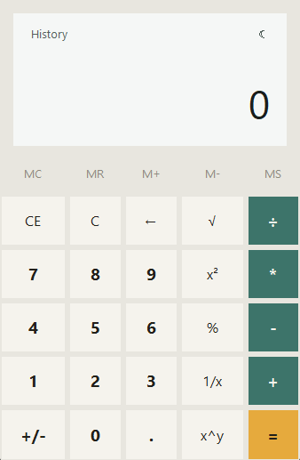
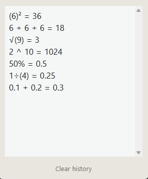
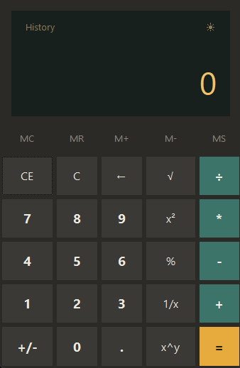
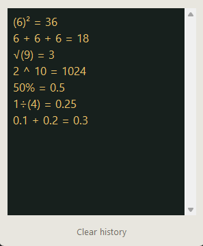

# oop-calculator

A desktop calculator built with Python, Tkinter and ttkbootstrap. The code is organized around MVC and an object-oriented hierarchy of operations, and the interface comes with memory keys, a calculation history and light and dark themes.

| | Calculator | History |
|---|---|---|
| **Light** |  |  |
| **Dark** |  |  |

## Features

- The four basic operations plus square root, square, percent, reciprocal and `x^y`
- Memory keys (`MC`, `MR`, `M+`, `M-`, `MS`) with an `M` indicator on the screen
- History of the last 50 calculations, newest first; clicking an entry brings its result back, and it can be cleared from the same window
- Chained calculations are logged in full (`6 + 6 + 6 = 18`, not just the last step)
- Light and dark themes, with the choice remembered between runs
- Thousands separators on the display and a result font that shrinks to fit long numbers, so the display scales when the window is resized
- Readable errors: dividing by zero shows `Error` with the reason above it, and the calculator ignores input until you press `C`
- Keyboard support

## Getting started

Python 3.8 or newer is required.

```
pip install -r requirements.txt
python main.py
```

The interface uses Segoe UI, so it looks best on Windows. On other systems Tk falls back to a default font and the layout still works, but the spacing may differ slightly.

### Keyboard

| Key | Action |
|---|---|
| `0`-`9`, `.` | Enter a number |
| `+` `-` `*` `/` | Operators |
| `Enter` | Equals |
| `Backspace` | Delete the last digit |
| `Esc` | Clear all |

## Project structure

```
oop-calculator/
├── main.py
├── conftest.py
├── requirements.txt
├── requirements-dev.txt
├── LICENSE
├── .gitignore
├── README.md
├── models/
│   ├── operations.py            # Operation hierarchy and CalculatorError
│   ├── memory.py                # Memory
│   └── history.py               # History
├── controller/
│   └── calculator_controller.py # all calculator logic, no Tkinter
├── view/
│   ├── calculator_view.py       # main window
│   ├── history_view.py          # history popup
│   └── theme.py                 # colors and fonts
├── utils/
│   ├── formatting.py            # number formatting and digit grouping
│   └── settings.py              # saved preferences
├── tests/
│   ├── test_calculator_controller.py
│   ├── test_formatting.py
│   ├── test_history.py
│   ├── test_memory.py
│   ├── test_operations.py
│   └── test_settings.py
└── docs/
    └── screenshots/
```

The code follows MVC, and the rule is strict in both directions: the controller never imports Tkinter, and the view contains no calculation logic. The view forwards every key press to the controller and then redraws itself from whatever the controller reports (display text, expression line, memory state). Because of that, the whole calculator can be tested without opening a window.

### Operations

Every operation is a class. `Operation` is an abstract base, with `BinaryOperation` (two operands) and `UnaryOperation` (one operand) below it, and each concrete operation such as `AddOperation` or `SqrtOperation` implements `execute()`. The controller keeps a dictionary that maps each button symbol to an operation object, so adding a new operation means writing one class and one dictionary entry. Operations that cannot produce a valid result raise `CalculatorError`, and the controller turns that into the error state.

### State

The controller owns a `Memory` and a `History` object and keeps the rest of the state itself: the number being typed, the pending operator, and the running expression. History entries are stored as plain `(expression, result)` pairs, and results are kept unformatted so that restoring one into the calculator gives a number it can compute with.

## Behavior worth knowing

- Calculations are evaluated left to right, like on a basic desk calculator, without operator precedence. `6 + 6 * 2` gives 24, and the history shows the steps in the order they were evaluated.
- Results are rounded to 12 significant digits, which hides float noise (`0.1 + 0.2` shows `0.3`). Whole numbers from 1e15 up are shown in scientific notation.
- Pressing two operators in a row replaces the first one instead of calculating.
- The theme preference is stored in `~/.oop_calculator.json`, outside the repository. If the file is missing or damaged, the calculator starts in light mode.

## Tests

```
pip install -r requirements-dev.txt
pytest
```

The tests cover the operations, memory, history, number formatting, settings and the controller. Controller tests drive it the same way the GUI does, by sending button symbols and checking the text it would display, so the GUI itself is not tested automatically.

## License

Released under the MIT License. See [LICENSE](LICENSE).
